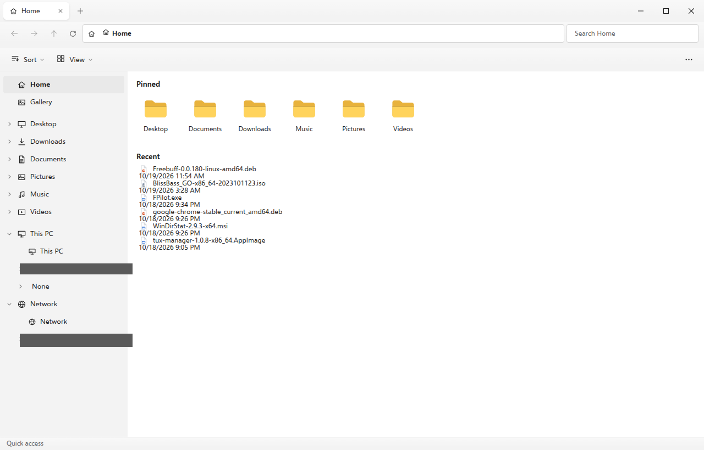
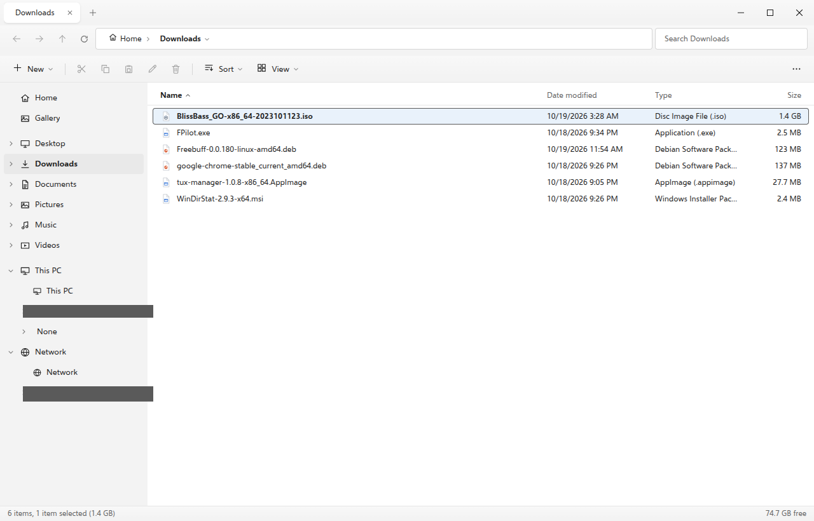
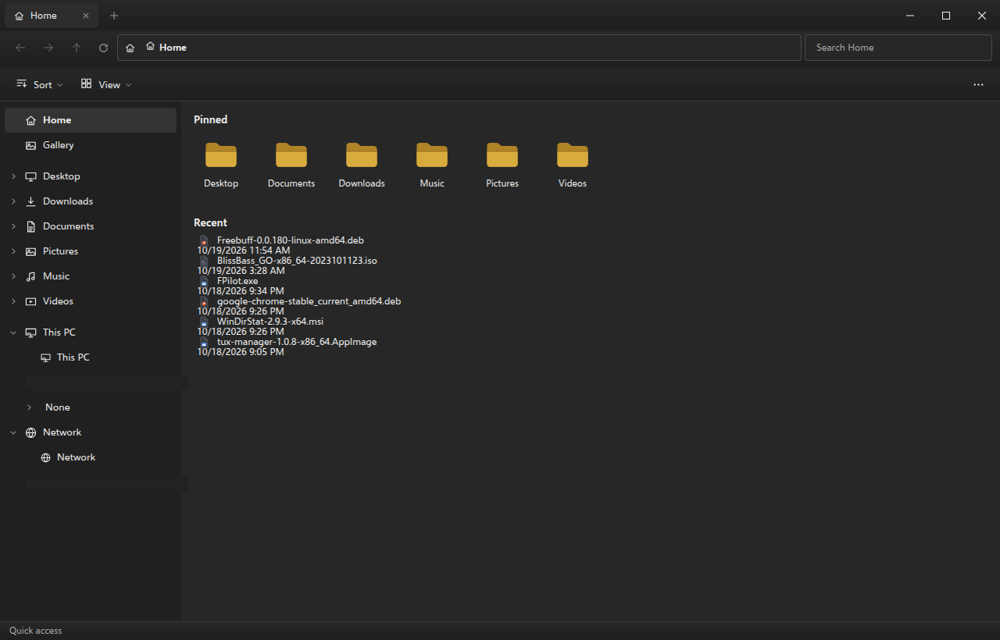
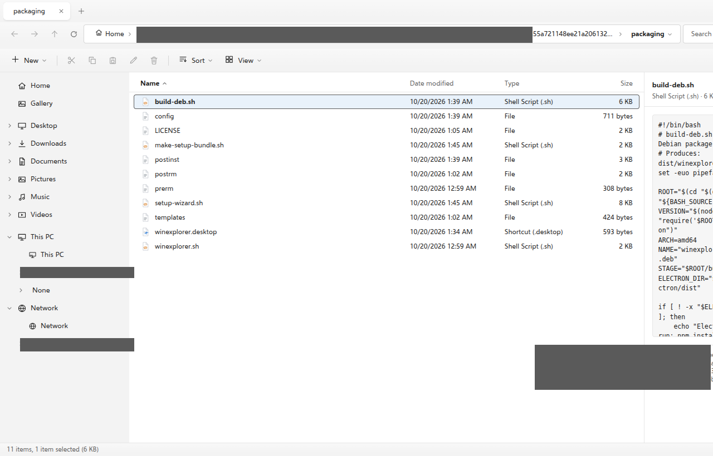
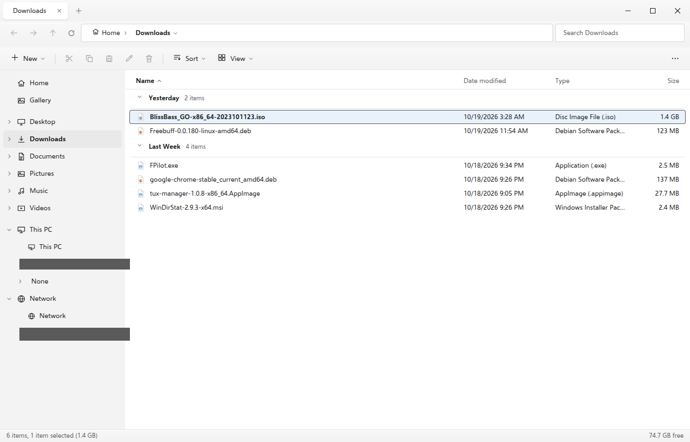

# Explorer for Linux — Windows 11 File Explorer clone

[](#install)
[](#how-it-works)
[](LICENSE)

**Windows 11 File Explorer for Linux** — a pixel-faithful recreation of the
Microsoft Explorer interface and workflow, built with Electron and packaged as
a real `.deb` for Debian-based distros (Ubuntu, Linux Mint, Pop!_OS, Debian,
Zorin OS). Fluent Design styling, tabbed browsing, Quick access, This PC, a
real FreeDesktop Recycle Bin and a Windows-style installer — a friendly
alternative to Nautilus / GNOME Files / Dolphin that just feels *familiar*.



| Details view | Dark mode |
|---|---|
|  |  |

| Preview pane (`Alt+P`) | Collapsible groups |
|---|---|
|  |  |

## How it works

The app is plain JavaScript — **no frameworks, no bundlers, no telemetry,
no network access at all**. Everything runs locally in an Electron window:

```
┌──────────────────────────────┐        ┌─────────────────────────────┐
│ Renderer (index.html + js/)  │  IPC   │ Main process (main.js)      │
│  · 8 view modes, tabs, menus │◄──────►│  · listing, copy/move, trash│
│  · Fluent CSS, dark theme    │ preload│  · drives, search, settings │
│  · dialogs, drag & drop      │ bridge │  · watchers, open-with       │
└──────────────────────────────┘        └──────────────┬──────────────┘
        shared/core.js — pure logic used by both sides and by the tests
                                                       │
                                          the real filesystem (/proc, lsblk,
                                          FreeDesktop trash, .desktop files)
```

* **`app/shared/core.js`** holds all pure logic (paths, sorting, grouping, the
  trash format, `.desktop` parsing) and is unit-tested directly under Node.
* **The Recycle Bin *is* the system trash** (`~/.local/share/Trash`): items
  deleted in Nautilus show up here and vice versa, with exact path restore.
* **This PC** reads `/proc/mounts` + `lsblk` for real drives and ejects via
  `udisksctl`; **Network** lists gvfs mounts (SMB/SFTP/Google Drive).
* **Settings** are a small JSON file in `~/.config/winexplorer/`.

See the [Architecture](#architecture) section below for the file-by-file tour.

## Features

| Windows 11 Explorer | This app |
|---|---|
| Tabbed title bar, New Tab `+`, Ctrl+T / Ctrl+W / Ctrl+Tab | ✔ |
| Command bar: **New ▾**, Cut, Copy, Paste, Rename, Delete, **Sort ▾**, **View ▾**, overflow `…` | ✔ |
| Breadcrumb address bar with per-segment dropdowns, editable path (`Ctrl+L` / `Alt+D`), Up/Back/Forward (`Alt+←/→/↑`) | ✔ |
| Search-as-you-type inside the current folder (`Ctrl+E`, `Ctrl+F`) | ✔ |
| Navigation pane: Home, Gallery, pinned folders, known folders, **This PC** (drives with capacity bars), Network — with **expandable folder tree** chevrons | ✔ |
| 8 view modes: Extra large / Large / Medium / Small icons, List, Details, Tiles, Content | ✔ |
| Details columns: sortable headers, **drag-to-resize**, **double-click to fit**, **right-click column chooser** | ✔ |
| Group by (None/Name/Date/Type/Size) with **collapsible group headers** | ✔ |
| Keyboard model: arrows, `Ctrl+Space` focus ring, `Enter`/`F2`, `Backspace` = Back, middle-click = new tab, Home/End/PageUp/PageDown | ✔ |
| **Preview pane** (`Alt+P`): images, video, audio and **text/code previews** | ✔ |
| **Per-folder view memory** — view/sort/group stick per folder | ✔ |
| Right-click menu with the Windows 11 icon row + “Show more options” classic menu | ✔ |
| Home (Quick access): Pinned folders | ✔ |
| Recycle Bin: real FreeDesktop.org trash, Restore / Delete permanently / Empty, `Delete` vs `Shift+Delete` | ✔ |
| Undo/Redo for cut/copy/paste/delete/rename/new (`Ctrl+Z` / `Ctrl+Y`) | ✔ |
| Properties dialog, “Open with…”, Folder-Options-style Options dialog | ✔ |
| Details pane (`Alt+Shift+P`), tooltips, status-bar selection size | ✔ |
| **This PC** drive cards with capacity bars, Eject for removable drives | ✔ |
| Dark mode following the system (or forced in Options) | ✔ |
| Windows-style installer + **“make me the default file manager”** prompt after install | ✔ |

### Extras beyond Windows

- **Gallery** groups pictures by month with on-disk thumbnails.
- **Send to ▸** (Desktop/Downloads/Documents or pick a folder).
- **Pin to Home** from any folder’s context menu.
- **Open in Terminal** (GNOME Terminal, Konsole, kitty, foot, xterm, …).
- Bounded search (2 000 results / 8 s) that never freezes the UI.
- Live refresh via filesystem watchers — external changes appear instantly.

## Install

### Option A — one command from source

```sh
git clone <this-repository> && cd <repo-folder>
./install.sh        # installs deps, runs tests, builds the .deb, installs it
```

`./install.sh --build-only` builds and tests without installing.

### Option B — the Windows-style setup wizard

```sh
tar xf explorer-setup.tar.gz
cd explorer-setup
./setup-wizard.sh      # Welcome → Agreement → progress → Finish
```

The wizard asks at the end whether to **set Explorer as your default file
manager** and whether to launch it — exactly like a Windows installer.

### Option C — the .deb directly

```sh
sudo dpkg -i winexplorer_1.0.0_amd64.deb
# or double-click the .deb in your file manager / Ubuntu Software
```

Installing the .deb asks via a setup question:

```
Make Explorer the default file manager?
```

If you install through a GUI software center (non-interactive), the app
itself asks **once on first launch** instead — same question, same choice.

### Uninstall

```sh
sudo apt remove winexplorer        # keeps your settings
sudo apt purge winexplorer         # also removes system default + settings marker
```

Settings live in `~/.config/winexplorer/`; Recycle Bin contents are untouched
FreeDesktop trash.

## Security & privacy

- **Zero network access** — the app never opens a socket: no telemetry, no
  analytics, no phone-home, no update pings. Your files never leave the machine.
- **No secrets, no accounts** — nothing to store, nothing to leak.
- Hardened Electron posture: `contextIsolation` on, `nodeIntegration` off, a
  strict preload IPC whitelist, a Content-Security-Policy, and all
  file names HTML-escaped (no XSS sinks).
- Every IPC operation runs with your own user permissions — the SUID Chromium
  sandbox ships like Chrome/VS Code so it keeps working on Ubuntu 23.04+.

## Develop

```sh
npm install          # fetches the Electron runtime (~110 MB)
npm start            # run from source
npm test             # unit tests (core logic + trash roundtrip)
npm run build:deb    # produce dist/winexplorer_<version>_amd64.deb
```

Useful launch flags (inherited from the real thing):

```sh
npm start -- /home/user/Downloads   # open a path in a new window
npm start -- --demo=thispc          # force a start page (used by CI screenshots)
npm start -- --screenshot=shot.png  # capture the window and exit (CI)
```

## Architecture

```
app/
├── main.js             Electron main: windows, IPC, drag-out, themes, CLI flags
├── preload.js          contextBridge → the single `wx` API surface
├── index.html          UI shell (with CSP)
├── shared/core.js      pure logic shared by main, renderer and tests:
│                       paths, formatting, type model, sorting/grouping,
│                       FreeDesktop trash format, .desktop/Exec parsing
├── services/           main-process modules
│   ├── listing.js      dir listing, watchers, bounded search, gallery scan
│   ├── fsops.js        copy/move with progress + cancellation
│   ├── trash.js        FreeDesktop.org trash spec (deterministic names → exact restore)
│   ├── drives.js       /proc/mounts + lsblk → This PC drives, udisks eject/mount
│   ├── system.js       open-with registry, terminal here, default file manager
│   └── settings.js     JSON settings store
├── js/                 renderer modules (plain scripts, no bundler)
│   ├── state.js        tabs, history, selection, undo/redo, load pipeline
│   ├── render.js       8 view modes, grouping, Home/ThisPC/Bin/Gallery/Network
│   ├── toolbar.js      tab strip, breadcrumb address bar, command bar
│   ├── navpane.js      navigation pane + folder tree + resize splitter
│   ├── menus.js        Fluent popup menus + every context menu
│   ├── actions.js      single command registry (menus, bar, shortcuts)
│   ├── dialogs.js      properties, open-with, options, conflicts, prompt
│   ├── ops.js          clipboard, delete/restore, new-item, send-to, drives
│   ├── dnd.js          drag & drop (incl. from/to other apps) + marquee select
│   └── app.js          boot, keyboard shortcuts, preview pane, status bar
└── assets/             generated PNG icons
packaging/              deb build inputs + Windows-style setup wizard
tests/run-tests.js      dependency-free node test suite
install.sh              one-command build + install script
```

## Notes on Linux fidelity

- The Recycle Bin **is** the FreeDesktop trash — restore writes back the
  original path, timestamps included.
- “This PC” lists real mounts (filtered from `/proc/mounts`, labels from
  `lsblk`); removable devices eject via `udisksctl`.
- The default-file-manager integration uses the standard `inode/directory`
  MIME handler; Explorer works with GNOME, KDE, XFCE …
- The Chromium sandbox ships SUID-root like Chrome/VS Code.

MIT licensed. Electron © GitHub, Inc.; Chromium © Google LLC.
